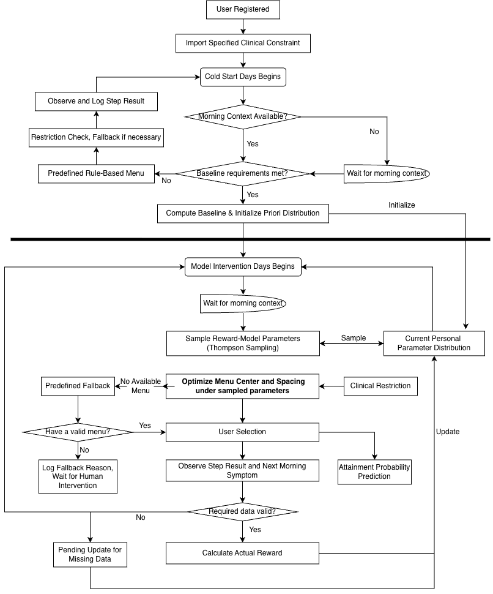

# MovingHearts: Personalized Step-Goal Model

## Overview

A personalized step-goal system designed to support sustained improvement in daily activity while keeping symptoms and intervention burden manageable. Each morning, the system produces a menu of three step goals—**low**, **recommended**, and **high**—and uses a contextual bandit to adapt menu selection over time.

The objective is sustained improvement in average daily steps relative to each participant's baseline, without clinically meaningful symptom deterioration or unacceptable burden. Goal attainment, streaks, and app engagement are not optimization objectives by themselves.

## Workflow

The following diagram summarizes the cold-start phase, intervention-day decision process, fallback handling, and reward updates.

## Inputs and Daily Output

| Input | Role in V1 |
| --- | --- |
| Activity and goal history | Informs candidate menus and recent activity level |
| Daily morning symptoms | Constrains feasible menus |
| Weather | Additional constraint, lower priority than symptoms |
| Data quality | Identifies missing or abnormal records |

Weekly PROMIS-29 and engagement/life-context features are not included in V1 decisions.

Each menu is parameterized by a **center** (`c`, the recommended goal) and **spacing** (`d`):

$$
\mathrm{Menu}_t = (c_t-d_t,\; c_t,\; c_t+d_t)
$$

The algorithm selects a feasible `(c, d)` pair after applying clinical and day-to-day change constraints. The offered menu, participant selection, and actual steps are logged.

## Reward Prediction Model

V1 uses a reward-prediction model with **11 coefficients**, incorporating recent activity, symptoms, weather, relative menu center and spacing, and quadratic/interaction effects.

The coefficient vector is

$$
\theta = \left(\theta_0\; \theta_a\; \theta_f\; \theta_w\; \theta_c\; \theta_{cc}\; \theta_d\; \theta_{dd}\; \theta_{cd}\; \theta_{cf}\; \theta_{cw}\right)^\top.
$$

For a candidate menu parameterized by `(c, d)`, the feature vector is

$$
x_t(c,d)=\left(1\; a_t\; f_t\; w_t\; z_c\; z_c^2\; z_d\; z_d^2\; z_c z_d\; z_c f_t\; z_c w_t\right)^\top
$$

with normalized menu variables

$$
z_c = \frac{c-B}{D}, \qquad z_d = \frac{d}{D}.
$$

The predicted reward is

$$
\hat{R}_t(c,d;\theta)=\theta_0 + \theta_a a_t + \theta_f f_t + \theta_w w_t
+ \theta_c z_c + \theta_{cc} z_c^2
+ \theta_d z_d + \theta_{dd} z_d^2
+ \theta_{cd} z_c z_d
+ \theta_{cf} z_c f_t + \theta_{cw} z_c w_t.
$$

Here, `a_t` is recent activity, `f_t` is symptom burden, `w_t` is weather, `B` is baseline step count, and `D` is the step scale.

## Learning Model and Thompson Sampling

V1 uses **individual Bayesian linear regression** with fixed Gaussian observation noise and **Thompson sampling**.

Each participant starts from a common prior:

$$
\theta \sim \mathcal{N}(\mu_0, \Sigma_0).
$$

The initial means are zero for all coefficients. The initial standard deviations are:

- `0.5` for $\theta_0, \theta_a, \theta_f, \theta_w, \theta_c, \theta_d$
- `0.25` for $\theta_{cc}, \theta_{dd}, \theta_{cd}, \theta_{cf}, \theta_{cw}$

Equivalently, the diagonal prior covariance uses variances `0.25` or `0.0625`.

For each daily decision:

1. Apply clinical constraints to identify feasible menus.
2. Sample parameters from the participant's posterior distribution.
3. Predict rewards for feasible `(c, d)` choices and select a menu.
4. Present low, recommended, and high goals for participant choice.
5. Once actual steps and next-morning symptoms are available, calculate reward and update the participant's posterior.

Each participant learns from their own valid intervention observations. V1 uses a common prespecified prior and **does not use cross-participant pooling**.

## Separate Attainment Prediction

A per-participant **Bayesian logistic regression** model is proposed to estimate goal-attainment probability and uncertainty. Its predictions are **not used for V1 menu decisions**.

The probability model is

$$
p = \frac{1}{1 + e^{-z}}
$$

with score

$$
z = \beta_0 + \beta_1 q + \beta_2 a + \beta_3 f + \beta_4 c + \beta_5 m.
$$

This component is intended for probability estimation, uncertainty reporting, and later calibration analysis rather than menu selection in V1.

## Actual Reward and Outcome Update

Daily reward reflects **actual step improvement relative to baseline** together with a **penalty for worsening symptoms**. It is not determined solely by whether the selected goal was achieved.

The daily reward is

$$
R_t = \operatorname{clip}\!\left(\frac{S_t-B}{D},\; -1,\; 1\right) - \lambda_s W_t
$$

where the symptom-deterioration term is

$$
W_t = \operatorname{clip}\!\left(\frac{\max(0, F_{t+1}-F_t)}{K},\; 0,\; 1\right).
$$

Here, `S_t` is actual daily steps, `F_t` is the current-morning symptom score, `F_{t+1}` is the next-morning symptom score, `K` is the symptom-change scale, and `\lambda_s` is the symptom penalty weight.

Missing step or symptom outcomes **defer** model updates; they are not treated as zero activity or zero symptom change.

## Cold Start and Fallback

The proposed baseline observation period is **7 days with at least 5 valid activity days**. Before sufficient data are available, decisions use predefined rule-based defaults and conservative bounds. Baseline observations do not train the menu-reward model.

Symptom alerts, missing context, model failure, or absence of an eligible menu trigger predefined fallback or escalation procedures. Every offered goal must satisfy clinical constraints.

## Evaluation Plan

**Offline:** Simulate participant context, menu choice, actual steps, and next-morning symptoms. Compare the adaptive policy against a predefined rule-based policy, using average reward, activity improvement, symptom deterioration, constraint violations, and fallback frequency. Include missing data, behavioral changes, and cases where adaptation provides no benefit.

**Online:** Begin with a supervised feasibility pilot before a controlled study. The planned no-app control evaluates the **complete intervention**, not the bandit alone. Outcomes include sustained change in daily steps, symptoms, PROMIS-29 trends, intervention burden, dropout, and secondary engagement and goal-attainment measures. Study size, duration, safety thresholds, and clinical response procedures remain to be specified with the team.

## Limitations

- One observation per participant per day may be insufficient to estimate all model coefficients reliably.
- The reward model and short outcome window may not capture long-term effects.
- Participant choice and limited menu variation complicate causal interpretation.
- Missing data and changing behavior can bias learning.
- Simulations cannot establish clinical effectiveness; the no-app comparison cannot isolate the bandit's contribution.

**Background references named in the proposal:** HeartSteps, DIAMANTE, Fit2ThriveMB.
